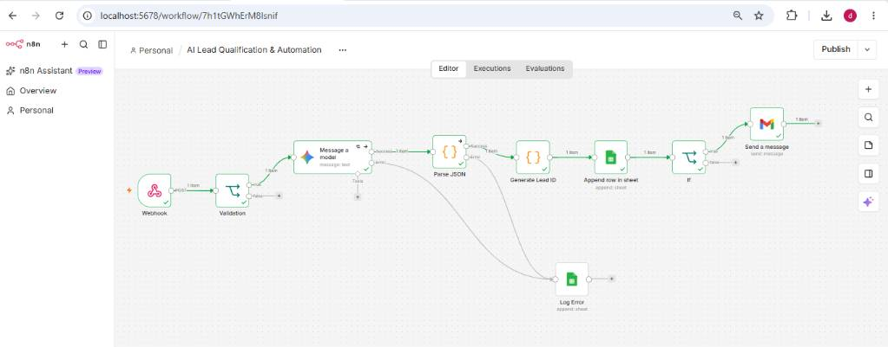
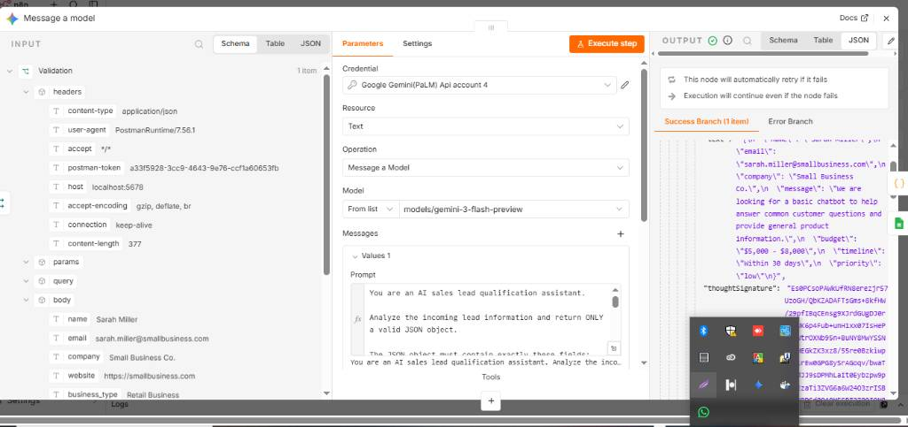
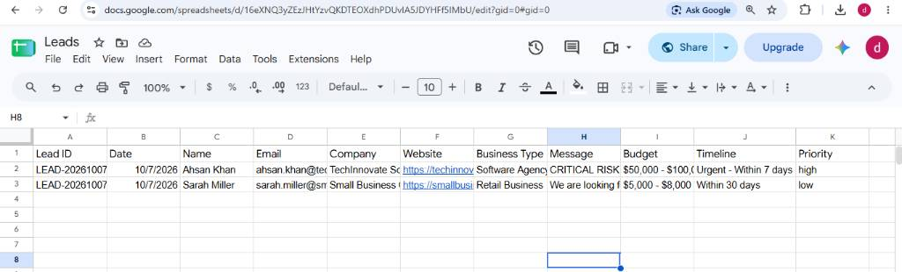
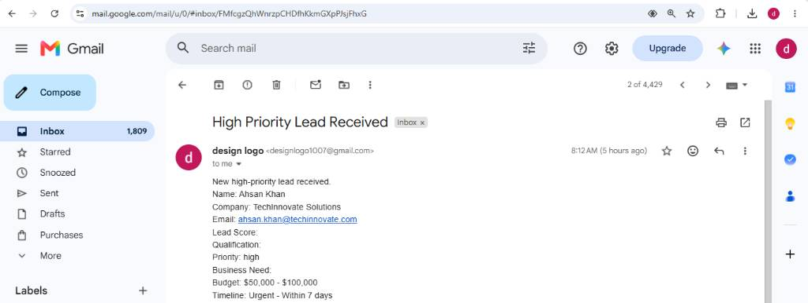
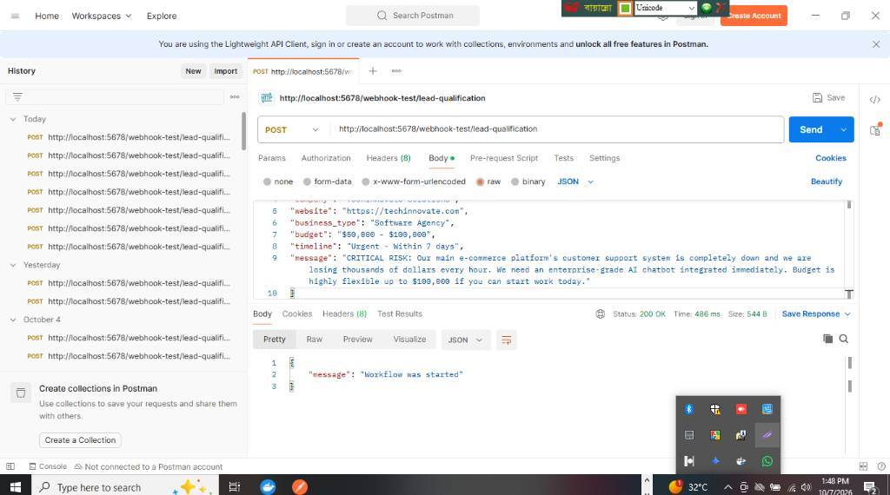

# AI Lead Qualification & Automation

An AI-powered lead qualification and automation workflow built with **n8n** and **Google Gemini**. The system receives lead information through a webhook, validates the input, uses Gemini AI to determine lead priority, stores the result in Google Sheets, and sends a Gmail notification for high-priority leads.

## Workflow Layout
```text
Lead ➔ Webhook ➔ Validation ➔ Google Gemini AI ➔ JSON Parsing ➔ Generate Lead ID ➔ Google Sheets ➔ Priority Check
                                                                                                       ├── High ➔ Gmail Notification
                                                                                                       └── Low ➔ End Workflow
```

## Key Features
* **Webhook-based Lead Intake** — Captures incoming leads automatically via webhooks.
* **Input Validation** — Checks data integrity before passing it to the AI.
* **AI-powered Lead Qualification** — Integrates Google Gemini (`models/gemini-3-flash-preview`) for smart lead screening.
* **Structured JSON Processing** — Ensures data is parsed accurately into clean JSON format.
* **Automatic Lead ID Generation** — Generates unique identifiers for each incoming lead.
* **Google Sheets Storage** — Centralizes all qualified and filtered leads in a structured spreadsheet.
* **Priority-based Routing & Notifications** — Triggers immediate Gmail alerts only for high-priority opportunities.

## AI Qualification Criteria
Gemini evaluates the incoming leads based on corporate rules involving budget and urgency metrics:

| Condition | Assigned Priority | Action Taken |
| :--- | :--- | :--- |
| **Budget over \$20,000** | High | Stores in Google Sheets + Sends **Gmail Notification** |
| **Urgent or critical requirement** | High | Stores in Google Sheets + Sends **Gmail Notification** |
| **Otherwise** | Low | Stores in Google Sheets + Ends Workflow |

### Expected Output Fields:
The AI is strictly structured to return a valid JSON object containing: `name`, `email`, `company`, `message`, `budget`, `timeline`, and `priority`.

### Example AI JSON Result:
```json
{
  "name": "Ahsan Khan",
  "email": "ahsan.khan@techinnovate.com",
  "company": "TechInnovate Solutions",
  "message": "CRITICAL RISK: Our main e-commerce platform's customer support system is completely down.",
  "budget": "$50,000 - $100,000",
  "timeline": "Urgent - Within 7 days",
  "priority": "high"
}
```

## Technology Stack
* **n8n** — Core workflow automation.
* **Google Gemini** — AI qualification engine (`models/gemini-3-flash-preview`).
* **Google Sheets** — Persistent cloud lead storage.
* **Gmail** — Automated high-priority alerts.
* **Docker** — Local n8n server environment.
* **Postman** — API/Webhook endpoint testing client.

## Project Structure
```text
AI-Lead-Qualification-Automation/
│
├── README.md
├── workflow/
│   └── lead-qualification-workflow.json
├── prompts/
│   └── lead-analysis-prompt.txt
├── test-data/
│   ├── high-priority-lead.json
│   └── low-priority-lead.json
├── docs/
│   ├── architecture.md
│   └── setup.md
└── screenshots/
    ├── 01-full-workflow.png
    ├── 02-gemini-ai-qualification.png
    ├── 03-google-sheets-results.png
    ├── 04-gmail-high-priority-notification.png
    └── 05-postman-api-test.png
```

## Screenshots
### 📊 Full Workflow Layout


### 🧠 Gemini AI Qualification Setup


### 📈 Google Sheets Results


### ✉️ Gmail High-Priority Notification


### 🚀 Postman API Testing


## Documentation Reference
* `docs/architecture.md` — Detailed system architecture and structural design.
* `docs/setup.md` — Installation, API credentials configuration, and webhook testing.
* `prompts/lead-analysis-prompt.txt` — Core Gemini AI system instruction prompt template.

## Business Value
* **Identify High-Priority Leads Quickly** — Respond to massive business opportunities instantly.
* **Reduce Manual Overhead** — Eliminate traditional manual lead screening and data transfer tasks.
* **Centralize Information** — Keep data cleanly backed up in Google Sheets for sales teams.

## Future Extensions
The automation architecture supports easy scaling for:
* CRM platform integrations (Salesforce, HubSpot).
* Database logging (PostgreSQL, MongoDB).
* Multi-channel messaging (WhatsApp, Telegram, Slack).
* AI-driven personalized automated follow-up emails.

## License
This project is intended for portfolio demonstration and educational purposes.