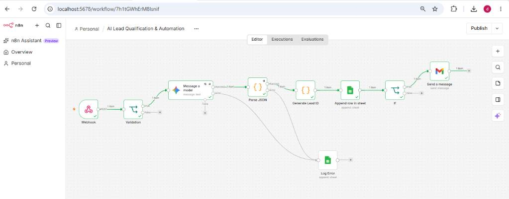
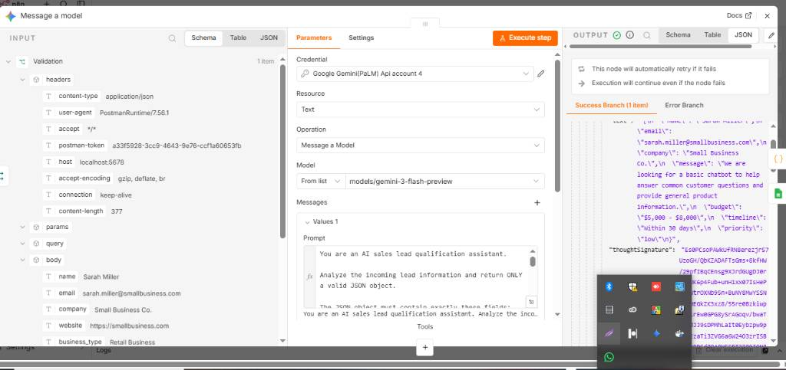
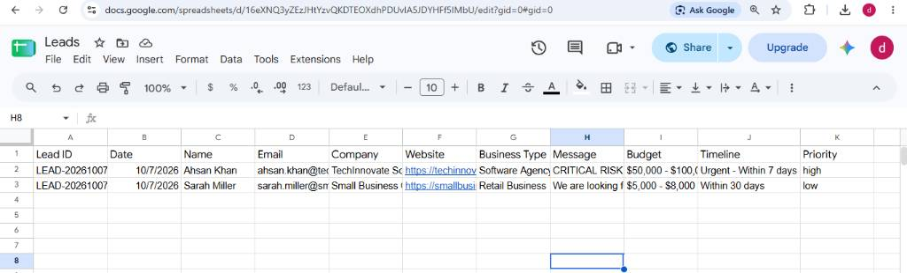

# AI Lead Qualification & Automation

An AI-powered lead qualification and automation workflow built with **n8n** and **Google Gemini**. The system receives lead information through a secured webhook, validates incoming data, uses Gemini AI to evaluate and classify leads, and stores the results in Google Sheets.

The workflow also includes error handling and an unscored lead fallback to help prevent lead data from being lost when AI processing or JSON parsing fails.

## Workflow Layout

```text
Lead
  |
  v
Webhook (Header Auth)
  |
  v
Input Validation
  |
  +---- Invalid Input ----> Respond 400 - Validation Error
  |
  v
Google Gemini AI
  |
  +---- AI Error ----------------------+
  |                                    |
  v                                    |
JSON Parsing                           |
  |                                    |
  +---- Invalid JSON ------------------+
  |                                    |
  v                                    v
Generate Lead ID                 Build Unscored Lead
  |                                    |
  v                                    v
Google Sheets                    Save Unscored Lead
  |                                    |
  v                                    v
Priority Check                    Log Error
  |                                    |
  +---- High                          |
  |       |                            |
  |       v                            |
  |   Gmail Notification              |
  |   (Deactivated)                   |
  |       |                            |
  +---- Medium                         |
  |       |                            |
  +---- Low                            |
          |                            |
          v                            v
       Respond 200 - Success <---------+
```

**Note:** High, Medium, Low, and Unscored processing paths currently use the shared `Respond 200 - Success` node. Invalid input uses a separate HTTP 400 response.

## Key Features

- **Webhook-based Lead Intake:** Receives incoming lead information through an n8n webhook.
- **Header Authentication:** Protects the webhook using Header Auth and an API key.
- **Input Validation:** Checks required fields and basic email validity before AI processing.
- **AI-powered Lead Qualification:** Uses Google Gemini (`models/gemini-3-flash-preview`) to evaluate incoming leads.
- **Structured JSON Processing:** Parses and validates the AI-generated JSON response.
- **Automatic Lead ID Generation:** Generates a unique lead identifier.
- **Google Sheets Storage:** Stores lead information and qualification results.
- **Lead Scoring & Classification:** Generates a numerical score and classifies leads as Hot, Warm, or Cold.
- **Priority-based Routing:** Routes leads according to High, Medium, or Low priority.
- **Unscored Lead Fallback:** Saves leads for manual review when Gemini processing or JSON parsing fails.
- **Error Logging:** Records AI or parsing errors through the error-handling path.
- **HTTP Response Handling:** Returns HTTP 400 for invalid input and HTTP 200 for accepted requests.

## AI Qualification Criteria

Gemini evaluates incoming leads based on the provided budget, timeline, business requirements, and urgency.

| AI Classification | Priority | Intended Handling |
|---|---|---|
| Hot | High | Save to Google Sheets; optional Gmail notification |
| Warm | Medium | Save to Google Sheets |
| Cold | Low | Save to Google Sheets |

The priority classification is determined by the AI qualification prompt. These classifications are AI-generated suggestions, not deterministic business rules or final sales decisions.

## AI Output & Data Structure

The AI qualification response contains six AI-generated fields:

- `priority`
- `lead_score`
- `qualification`
- `business_need`
- `recommended_action`
- `ai_reason`

These fields are combined with the original lead information, such as:

- `name`
- `email`
- `company`
- `message`
- `budget`
- `timeline`

The normal Google Sheets output contains 16 columns:

| Field | Description |
|---|---|
| Lead ID | Generated unique identifier |
| Date | Lead processing date |
| Name | Lead's name |
| Email | Lead's email address |
| Company | Company name |
| Website | Optional website |
| Business Type | Optional business category |
| Message | Lead's inquiry |
| Budget | Stated budget |
| Timeline | Expected timeline |
| Priority | High, Medium, or Low |
| Lead Score | AI-generated numerical score |
| Qualification | Hot, Warm, or Cold |
| Business Need | Identified business requirement |
| Recommended Action | Suggested next action |
| AI Reason | AI-generated qualification explanation |

**Important:** The Unscored Lead fallback stores the available core lead information and marks the qualification as `unscored`. Optional `website` and `business_type` fields are not currently retained by this fallback path.

### Example AI JSON Result

```json
{
  "priority": "high",
  "lead_score": 85,
  "qualification": "hot",
  "business_need": "AI customer support chatbot",
  "recommended_action": "Contact the lead immediately",
  "ai_reason": "High budget and urgent business requirement."
}
```

The example is for demonstration purposes. Actual AI output may vary.

## Error Handling & HTTP Responses

### 1. Invalid Input

The Validation node checks the required fields:

- Name
- Valid email
- Company
- Message

Invalid input is rejected with:

- HTTP Status: `400 Bad Request`
- Response message: `Validation Failed`

### 2. Authentication Failure

The webhook uses Header Auth.

- Correct API key: Request can proceed to validation.
- Incorrect or missing API key: Authentication is rejected with HTTP `403 Forbidden`.

### 3. Gemini or JSON Parsing Failure

If Gemini processing fails or the AI response cannot be parsed:

1. The lead is routed to the Unscored Lead fallback.
2. The available lead information is saved to Google Sheets.
3. The error is recorded through the Log Error node.
4. The workflow returns through the shared HTTP 200 response node.

The fallback does not assign a normal AI score or qualification.

**Note:** The HTTP 200 response indicates that the request was accepted and handled by the workflow. It does not mean AI qualification was successful. Unscored leads require manual review.

## Testing & Verification

### Day 3 — Lead Qualification Tests

Four lead qualification test cases were completed:

| Test Case | Result |
|---|---|
| High Lead | Hot / High — PASS |
| Warm Lead | Warm / Medium — PASS |
| Cold Lead | Cold / Low — PASS |
| Bengali Lead | Hot / High — PASS |

Bengali Lead Verification:

- Lead Score: 85
- Qualification: Hot
- Priority: High
- Bengali message successfully stored in Google Sheets.

Detailed results: `test-results/day3-lead-tests.md`

### Day 4 — Workflow Hardening Tests

| Test | Expected Result | Status |
|---|---|---|
| Invalid or missing required input | HTTP 400 | PASS |
| Correct Header Auth API key | HTTP 200 for valid request | PASS |
| Incorrect Header Auth API key | HTTP 403 | PASS |
| Gemini API failure | Save lead as unscored | PASS |
| Invalid AI JSON response | Route to unscored fallback | PASS |
| Normal AI processing after restoring credentials | Save qualified lead | PASS |

Detailed results: `test-results/day4-lead-hardening.md`

These tests verify the workflow behavior described above. They do not imply that every possible input or production scenario has been tested.

## Gmail Notification Status

The High Priority Gmail notification node is currently deactivated because Gmail OAuth configuration is pending.

The node is retained as an optional integration but has not yet been verified.

## Security Notes

- The webhook is protected using n8n Header Auth.
- The API key is stored in n8n credentials and is not included in the exported workflow.
- The exported workflow uses placeholders for sensitive configuration values, including Google Sheets Document ID, Header Auth credential ID, and notification email.
- API keys, credential IDs, and other private configuration values must be configured separately after importing the workflow.
- The webhook URL and API key are not stored in this repository.
- Use dummy contact information in public test data.

Never publish real API keys, credentials, private webhook URLs, or confidential lead information.

## Technology Stack

| Technology | Purpose |
|---|---|
| n8n | Core workflow automation |
| Google Gemini | AI qualification and lead scoring |
| Google Sheets | Lead data storage |
| Gmail | Optional High Priority notification |
| Docker | Local n8n server environment |
| PowerShell / Postman | Webhook and API testing |

## Project Structure

```text
AI-Lead-Qualification-Automation/
│
├── README.md
├── workflow/
│   └── lead-qualification-workflow.json
│
├── prompts/
│   └── lead-analysis-prompt.txt
│
├── test-data/
│   ├── high-priority-lead.json
│   └── low-priority-lead.json
│
├── test-results/
│   ├── day3-lead-tests.md
│   └── day4-lead-hardening.md
│
├── docs/
│   ├── architecture.md
│   └── setup.md
│
└── screenshots/
    ├── 01-full-workflow.png
    ├── 02-gemini-ai-qualification.png
    └── 03-google-sheets-results.png
```

## Screenshots

### Full Workflow Layout



### Gemini AI Qualification Setup



### Google Sheets Results



## Documentation Reference

- `docs/architecture.md` — System architecture and workflow design.
- `docs/setup.md` — Installation, credential configuration, and webhook testing instructions.
- `prompts/lead-analysis-prompt.txt` — Gemini lead qualification prompt.
- `test-results/day3-lead-tests.md` — Day 3 qualification test results.
- `test-results/day4-lead-hardening.md` — Day 4 hardening and error-handling test results.

## Business Value

- **Faster Lead Screening:** Helps identify potentially valuable leads.
- **Reduced Manual Work:** Automates initial lead evaluation and data entry.
- **Centralized Lead Management:** Keeps lead information and AI-generated results organized in Google Sheets.
- **Improved Error Handling:** Preserves available lead information when AI qualification fails.

## Future Extensions

Potential future improvements include:

- Gmail OAuth configuration and verified email notifications.
- CRM integrations such as Salesforce and HubSpot.
- CRM integration (for example HubSpot or Airtable) for lead status tracking, duplicate detection, and follow-up reminders.
- Database logging with PostgreSQL.
- Multi-channel messaging integrations such as WhatsApp, Telegram, and Slack.
- AI-assisted personalized follow-up emails.
- Dedicated HTTP responses for different processing outcomes.

These are potential extensions and are not claimed as completed features.

## License

This project is intended for portfolio demonstration and educational purposes.